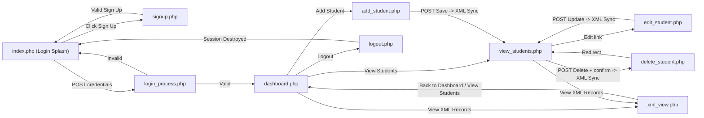

# USIAMS System Architecture

## 1. Layered Architecture
USIAMS follows a clean 4-layer procedural PHP architecture without external frameworks:

| Layer | Components | Responsibilities |
| --- | --- | --- |
| **Presentation Layer** | `index.php`, `signup.php`, `dashboard.php`, `add_student.php`, `view_students.php`, `edit_student.php`, `xml_view.php`, `includes/header.php`, `includes/footer.php`, `css/style.css` | Semantic HTML5 forms/tables, shared responsive layout, active navbar highlighting, and output escaping via `esc()`. |
| **Validation Layer** | `js/validation.js`, `includes/validators.php` | Identical client-side (`blur` + `submit`) and server-side (`POST`) validation rules returning `field => message` errors. |
| **Security & Control Layer** | `includes/auth.php`, `login_process.php`, `logout.php`, `delete_student.php` | Safe session startup (`session.use_strict_mode=1`, `httponly`), `require_login()` anti-cache guard, `password_hash()`/`password_verify()`, `session_regenerate_id(true)`, per-session CSRF tokens (`hash_equals()`), and `403` direct-include guards. |
| **Data Access & XML Sync Layer** | `includes/db.php`, `includes/xml_helper.php`, `sql/usiams.sql`, `students.xml` | Reusable `mysqli` connection (`utf8mb4`), `execute_prepared()` prepared-statement wrapper, atomic `DOMDocument` XML regeneration, and MySQL `usiams_db` persistence (`users`, `students`). |

---

## 2. Data Flow (Write Operation: Add / Edit / Delete)
```text
User Input (Browser Form)
  │
  ▼
[1] Client-Side Validation (js/validation.js)
  │  Validates on blur & submit; blocks bad input with .error text
  ▼
[2] HTTP POST + Session CSRF Token
  │  Includes hidden csrf_token field
  ▼
[3] Session Guard & CSRF Check (includes/auth.php)
  │  require_login() + verify_csrf_token()
  ▼
[4] Server-Side Validation (includes/validators.php)
  │  Re-runs identical PHP rules; redisplays escaped input on error
  ▼
[5] Prepared Statement Execution (includes/db.php)
  │  execute_prepared() updates MySQL usiams_db.students
  ▼
[6] Atomic XML Regeneration (includes/xml_helper.php)
  │  Reads students ordered by reg_no -> DOMDocument -> temp file -> rename() -> students.xml
  ▼
[7] PRG Redirect & Escaped Render
     Flash message stored in $_SESSION -> 302 Redirect -> view_students.php / xml_view.php (esc())
```

---

## 3. Page Navigation Flow

